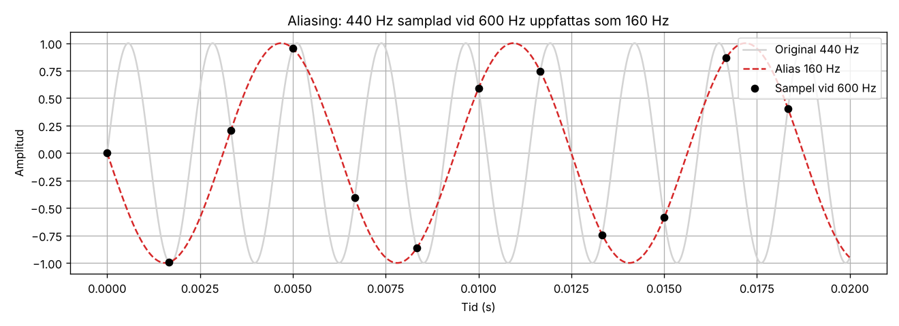
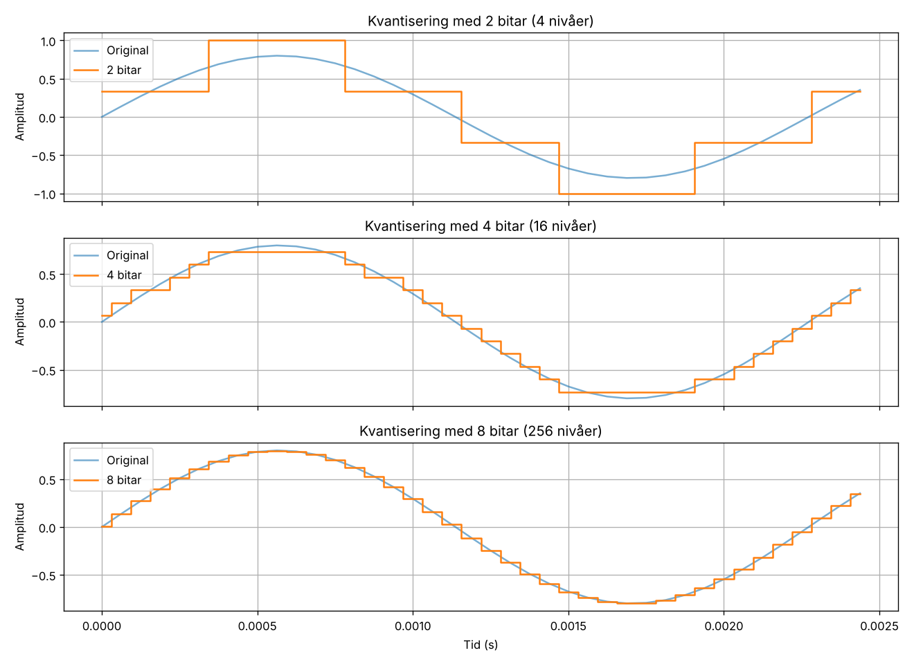

# Fredagsrapport – LIA Signaton

**Student:** Biljana Markovic  
**Utbildning:** DS25 – Data Scientist  
**LIA-företag:** Signaton  
**Handledare:** Sead Smailagic  
**Vecka:** 2 (v. 46)  
**Period:** 9–13 november 2026  
**Status:** Klar

---

## Sammanfattning på tre rader

1. Undersökte sampling, aliasing, kvantisering och WAV-hantering med en syntetisk 440 Hz-signal i Python och R.
2. Aliasing (440 → 160 Hz vid 600 Hz, 1 200 → 800 Hz vid 2 000 Hz) och SQNR (≈ 6 dB per bit) stämmer med teorin.
3. Inget blockerar. En fråga: ska rapportfigurer committas i `reports/figurer/` (se sektion 7)?

---

## 1. Veckans mål

- Mål 1: Förstå hur en analog signal representeras digitalt och hur samplingsfrekvensen påverkar representationen (Nyquist, aliasing).
- Mål 2: Undersöka hur bitdjupet påverkar kvantiseringsfelet (MSE och SQNR).
- Mål 3: Spara, läsa och kontrollera en WAV-fil i både Python och R.

## 2. Genomförda aktiviteter

- Genererade en 440 Hz sinus (amplitud 0,8, 16 kHz, 1 s) och samplade den med 16 000, 2 000 och 600 Hz.
- Beräknade förväntad aliasfrekvens med `|f − k·fs|` och verifierade den med FFT för fem kombinationer av signal och samplingsfrekvens.
- Implementerade kvantisering med 2, 4, 8 och 16 bitar och beräknade MSE, SQNR och teoretisk SQNR.
- Sparade signalen som 16-bit PCM WAV (`data/test_signal_440hz.wav`), läste tillbaka den och kontrollerade format, längd, amplitud och klippning.
- Läste samma WAV-fil i R med `tuneR` och upprepade alla experiment i `R/vecka_02_sampling.R`.
- Slog ihop notebook, R-skript och teori så att alla använder samma parametrar och exempel.

## 3. Tekniker och verktyg

**Programmeringsspråk:**  
Python / R

**Bibliotek och verktyg:**  
NumPy (signaler och FFT), SciPy (`scipy.io.wavfile`), Pandas (resultattabeller), Matplotlib, tuneR (WAV i R), Jupyter Notebook, Visual Studio Code

**Versionshantering:**  
Git och GitHub

## 4. Resultat och observationer

**Aliasing.** FFT-toppen stämde exakt med den förväntade frekvensen i alla fall:

| Signal | fs | Nyquist uppfyllt | Uppmätt frekvens |
|---|---|---|---|
| 440 Hz | 16 000 Hz | ja | 440 Hz |
| 440 Hz | 2 000 Hz | ja | 440 Hz |
| 440 Hz | 600 Hz | nej | **160 Hz** |
| 1 200 Hz | 8 000 Hz | ja | 1 200 Hz |
| 1 200 Hz | 2 000 Hz | nej | **800 Hz** |

Vid 600 Hz ger 440 Hz-signalen exakt samma sampel som en 160 Hz-sinus. Efter samplingen går de inte att skilja åt.

**Kvantisering.**

| Bitar | Nivåer | MSE | SQNR (dB) | SQNR teori (dB) |
|---|---|---|---|---|
| 2 | 4 | 4,77·10⁻² | 8,27 | 11,86 |
| 4 | 16 | 1,70·10⁻³ | 22,75 | 23,90 |
| 8 | 256 | 5,20·10⁻⁶ | 47,89 | 47,98 |
| 16 | 65 536 | 8,35·10⁻¹¹ | 95,84 | 96,14 |

SQNR ökar med cirka 6 dB per bit, som teorin förutsäger. Vid 2 bitar avviker resultatet från formeln eftersom den förutsätter många kvantiseringsnivåer.

**Data capture.** WAV-filen har 16 000 Hz, 1 kanal, 16 bitar, 16 000 sampel (1,0 s), peak 0,8, RMS 0,566 och inga klippta sampel. Python och R läser samma värden.

## 5. Utmaningar och problemlösning

- **WAV-filen hamnade i fel mapp.** Notebooken körs från `notebooks/`, så den relativa sökvägen `data/processed` skapade filen i `notebooks/data/processed/`. Löst genom att bygga alla sökvägar från projektroten (`ROOT / "data"`).
- **Dubbla experiment.** Notebooken innehöll först två versioner av aliasing och kvantisering med olika parametrar, och rapporten beskrev en annan version än notebooken. Efter handledarens feedback slogs allt ihop till en version per experiment, och notebook, R-skript och teori använder nu samma parametrar.
- **16 bitar visades som MSE = 0.** Fast decimalformat dolde värdet. Löst med vetenskaplig notation (8,35·10⁻¹¹).

## 6. Reflektion och lärdomar

Jag har lärt mig att samplingsfrekvensen avgör vilka frekvenser som kan representeras och att aliasing inte går att upptäcka eller ta bort i efterhand. Därför behövs antialiasfilter före sampling. Jag har också sett att varje extra bit ger cirka 6 dB bättre SQNR, vilket förklarar varför 16 bitar räcker för de flesta ljudtillämpningar.

En viktig lärdom är att hålla ett experiment på ett ställe, med samma parametrar i kod, teori och rapport, och att alltid använda sökvägar från projektroten. Det blir ännu viktigare när datapipelinen byggs i vecka 6.

Kunskaperna används direkt i vecka 3, där FFT och frekvensupplösning bygger vidare på samma signaler.

## 7. Planering inför nästa vecka

Vecka 3 (branch `vecka-03-fft`): FFT, fönsterfunktioner (rektangulär, Hamming, Hanning), spektralt läckage och PSD.

**Fråga till handledaren:** enligt git-flödet ska genererade figurer inte committas. Är det okej att committa de figurer som används i rapporterna i `reports/figurer/`, eller ska rapporterna i stället hänvisa till notebookens outputs?

## 8. Länkar och dokumentation

**GitHub:** [Repo](https://github.com/boskocat-blip/Signaton) · PR: [#1 Vecka 1–2](https://github.com/boskocat-blip/Signaton/pull/1)

**Notebooks:** [`notebooks/vecka_02_sampling_kvantisering_aliasing.ipynb`](../notebooks/vecka_02_sampling_kvantisering_aliasing.ipynb) · [`R/vecka_02_sampling.R`](../R/vecka_02_sampling.R)

**Rapporter:** [`docs/vecka_02_teori.md`](../docs/vecka_02_teori.md)
