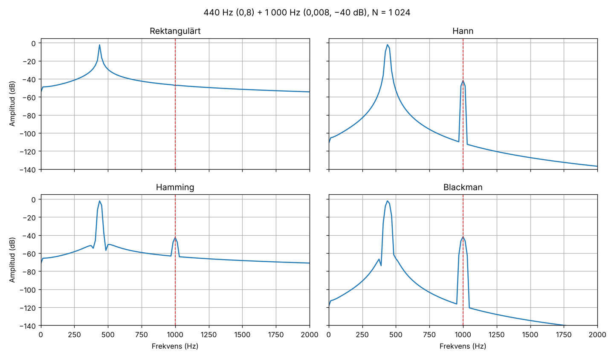
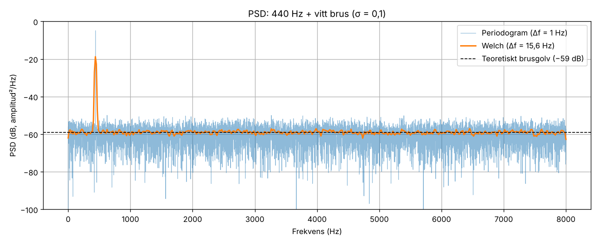

# Fredagsrapport – LIA Signaton

**Student:** Biljana Markovic  
**Utbildning:** DS25 – Data Scientist  
**LIA-företag:** Signaton  
**Handledare:** Sead Smailagic  
**Vecka:** 3 (v. 47)  
**Period:** 16–20 november 2026  
**Status:** Klar

---

## Sammanfattning på tre rader

1. Analyserade signaler i frekvensdomänen med FFT, jämförde fyra fönsterfunktioner och skattade PSD med periodogram och Welch, i både Python och R.
2. Alla mätningar stämmer med teorin: sidlober på −13/−31/−43/−58 dB, en −40 dB-ton syns bara med fönster, och PSD ger rätt brusgolv och SNR ≈ 15 dB.
3. Inget blockerar. Förslag: Hann-fönster och Welch-PSD som standard i pipelinen (se sektion 7).

---

## 1. Veckans mål

- Mål 1: Förstå och tillämpa FFT, inklusive frekvensupplösning och amplitudskalning.
- Mål 2: Förstå spektralt läckage och jämföra fönsterfunktioner (rektangulärt, Hann, Hamming, Blackman).
- Mål 3: Skatta effektspektraltäthet (PSD) med periodogram och Welch, och verifiera resultaten mot teorin, i Python och R.

## 2. Genomförda aktiviteter

- Beräknade amplitudspektrum för 440 Hz-signalen från vecka 2 med N = 16 000, 1 024 och 256 sampel.
- Visade spektralt läckage genom att jämföra 437,5 Hz (exakt på en bin) med 440 Hz (mellan två binar) vid N = 1 024.
- Implementerade fyra periodiska fönsterfunktioner, kontrollerade dem mot `scipy.signal.get_window` och beräknade koherent förstärkning, ENBW, högsta sidlob och huvudlobens bredd.
- Testade om en svag ton (1 000 Hz, −40 dB) går att hitta bredvid en stark ton (440 Hz) med varje fönster.
- Skattade PSD för en brusig signal (440 Hz + vitt brus, σ = 0,1) med periodogram och Welch och kontrollerade Parseval, brusgolv och SNR.
- Tillämpade metoderna på WAV-filen från vecka 2.
- Gjorde samma experiment i R med base `fft`, en egen Welch-funktion och `ggplot2`.

## 3. Tekniker och verktyg

**Programmeringsspråk:**  
Python / R

**Bibliotek och verktyg:**  
NumPy (`np.fft`), SciPy (`signal.get_window`, `signal.periodogram`, `signal.welch`, `io.wavfile`), Pandas, Matplotlib, R: base `fft`, ggplot2, tuneR, Jupyter Notebook, Visual Studio Code

**Versionshantering:**  
Git och GitHub (branch `vecka-03-fft`)

## 4. Resultat och observationer

**FFT och frekvensupplösning.** Med N = 16 000 (Δf = 1 Hz) hamnar toppen exakt på 440 Hz med amplitud 0,800. Med N = 1 024 (Δf = 15,6 Hz) och N = 256 (Δf = 62,5 Hz) hamnar toppen på närmaste bin, 437,5 Hz, och amplituden blir lägre (0,765 respektive 0,796) eftersom 440 Hz ligger mellan två binar.

**Fönsterfunktioner** (N = 1 024):

| Fönster | Koherent förstärkning | ENBW (bin) | Högsta sidlob | Huvudlob (bin) |
|---|---|---|---|---|
| Rektangulärt | 1,00 | 1,00 | −13,3 dB | 2 |
| Hann | 0,50 | 1,50 | −31,5 dB | 4 |
| Hamming | 0,54 | 1,36 | −42,7 dB | 4 |
| Blackman | 0,42 | 1,73 | −58,1 dB | 6 |

Värdena stämmer med teorin.

**Svag ton bredvid stark ton.** Med rektangulärt fönster ligger läckaget från 440 Hz på −47 dB vid 1 000 Hz och döljer helt tonen på −40 dB (framträdande −0,5 dB). Med Hamming syns tonen (+21 dB), och med Hann (+69 dB) och Blackman (+77 dB) syns den mycket tydligt.

**PSD.**

| Metod | Δf | Parseval (area) | Brusgolv, medel | Brusgolv, std | SNR |
|---|---|---|---|---|---|
| Periodogram | 1 Hz | 0,332 | 1,25·10⁻⁶ | 1,27·10⁻⁶ | 15,05 dB |
| Welch | 15,6 Hz | 0,332 | 1,26·10⁻⁶ | 0,23·10⁻⁶ | 15,04 dB |
| Teori | | 0,33 | 1,25·10⁻⁶ | | 15,05 dB |

Båda metoderna ger rätt effekt, brusgolv och SNR. Welch har cirka 5,6 gånger lägre spridning i brusgolvet, men grövre frekvensupplösning.

**WAV-filen.** FFT med Hann-fönster ger topp på 440 Hz med amplitud 0,800. Welch ger 437,5 Hz (närmaste bin), och PSD-arean (0,32) är lika med medeleffekten.

## 5. Utmaningar och problemlösning

- **Git i fel mapp.** Hemmappen (`C:\Users\bosko`) hade av misstag blivit ett Git-repo kopplat till ett annat projekt, och terminalen öppnades ibland i fel mapp (`Desktop\Signaton` i stället för `Projekt\Signaton`). `git status` visade då helt andra filer och `git rm` hittade inte mina filer. Löst genom att döpa om hemmappens `.git` (går att ångra) och alltid kontrollera att prompten slutar på `\Projekt\Signaton` innan jag kör git-kommandon.
- **Regler försvann ur `.gitignore`.** När filen ersattes i vecka 1–2 försvann bland annat `.env`, `data/raw/` och `venv/`. Jag upptäckte det med `git diff main -- .gitignore` och återställde reglerna före merge.
- **Gamla filer låg kvar i repot.** Ett gammalt R-skript (`scripts/vecka_02_audio_R.R`) och en WAV-fil i fel mapp togs bort med `git rm`.
- **R startade inte från PowerShell.** `R.exe` finns inte i PATH, så jag kör R via *R: Create R terminal* i VS Code. Paketet `ggplot2` installerades för graferna.
- **R och Python ger olika brus.** Slumptalsgeneratorerna skiljer sig åt, så brusvärdena blir inte identiska: SNR blev 15,00 dB i R och 15,05 dB i Python. Resultaten är ändå nästan desamma, vilket visar att metoden är robust.

## 6. Reflektion och lärdomar

Den här veckan var generellt svår för mig. FFT, fönsterfunktioner och PSD är nya begrepp som jag behöver lägga mer tid på för att verkligen förstå, och jag kommer att fortsätta gå igenom teorin och experimenten.

Det jag framför allt har lärt mig är att använda PowerShell och terminalen bättre, till exempel att kontrollera att jag står i rätt mapp innan jag kör git-kommandon.

Jag tror att kunskaperna från den här veckan kommer att behövas inom alla delar av projektet, och jag ser det som att jag precis har börjat lära mig.

## 7. Planering inför nästa vecka

Vecka 4 (branch `vecka-04-filter`): filterdesign med FIR och IIR, frekvensgång och tillämpning på ljud, i Python och R.

**Fråga till handledaren:** är det okej att använda Hann-fönster och Welch-PSD (1 024 sampel, 50 % överlapp) som standardinställning i den fortsatta pipelinen?

## 8. Länkar och dokumentation

**GitHub:** [Repo](https://github.com/boskocat-blip/Signaton) · PR: [#2 Vecka 3](https://github.com/boskocat-blip/Signaton/pull/2)

**Notebooks:** [`notebooks/vecka_03_fft_fonster_psd.ipynb`](../notebooks/vecka_03_fft_fonster_psd.ipynb) · [`R/vecka_03_fft_psd.R`](../R/vecka_03_fft_psd.R)

**Rapporter:** [`docs/vecka_03_teori.md`](../docs/vecka_03_teori.md)
