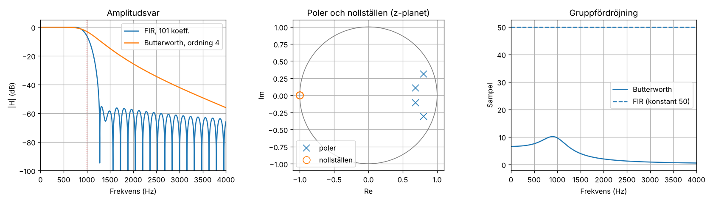
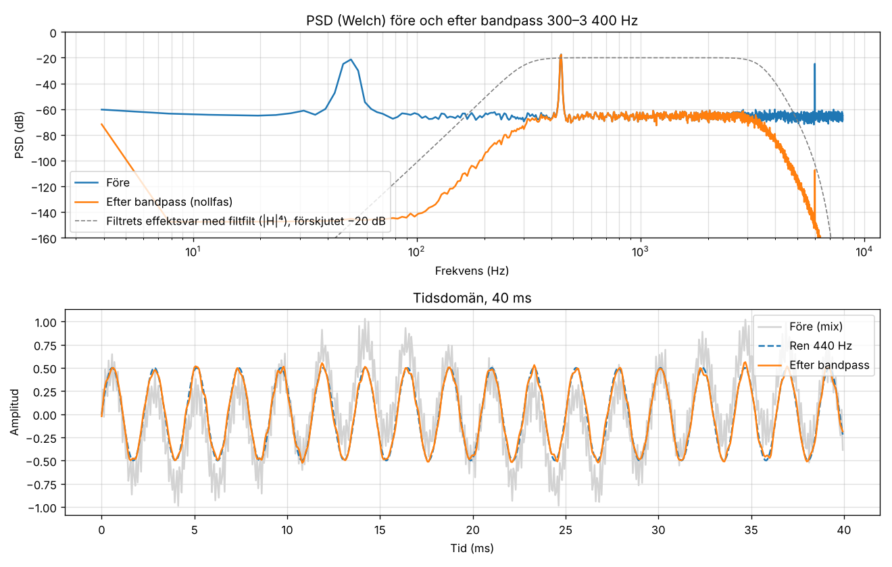

# Fredagsrapport – LIA Signaton

**Student:** Biljana Markovic  
**Utbildning:** DS25 – Data Scientist  
**LIA-företag:** Signaton  
**Handledare:** Sead Smailagic  
**Vecka:** 4 (v. 48)  
**Period:** 23–27 november 2026  
**Status:** Klar

---

## Sammanfattning på tre rader

1. Designade och jämförde ett FIR-lågpass (fönstermetoden) och ett IIR-lågpass (Butterworth) och använde ett bandpass 300–3 400 Hz på en brusig testsignal, i Python och R.
2. FIR gav linjär fas och −60 dB vid 2 000 Hz med 101 koefficienter; Butterworth gav −25 dB med 10 koefficienter. Bandpasset höjde SNR från 2,7 dB till cirka 21 dB.
3. Inget blockerar tekniskt, men jag behöver mer tid för att förstå filterteorin.

---

## 1. Veckans mål

- Mål 1: Förstå differensekvation, z-transform, poler och nollställen samt frekvenssvar.
- Mål 2: Designa och jämföra FIR- och IIR-filter (amplitudsvar, fas, fördröjning, stabilitet, beräkningskostnad).
- Mål 3: Tillämpa ett filter på ljud och mäta effekten med PSD och SNR, i Python och R.

## 2. Genomförda aktiviteter

- Beräknade frekvenssvaret för ett glidande medelvärde (M = 5) och jämförde med formeln.
- Designade ett FIR-lågpass med fönstermetoden (101 koefficienter, Hamming, 1 000 Hz) och visade att fördröjningen är konstant 50 sampel.
- Designade ett Butterworth-lågpass (ordning 4, 1 000 Hz), ritade poler och nollställen, kontrollerade stabiliteten och jämförde ordning 2, 4 och 8.
- Jämförde FIR och IIR i en tabell (koefficienter, dämpning, fördröjning, fas, stabilitet).
- Filtrerade en testsignal (440 Hz + brum 50 Hz + störton 6 000 Hz + brus) med bandpass 300–3 400 Hz och nollfasfiltrering, och mätte varje komponent och SNR före och efter.
- Gjorde samma beräkningar i R med paketet `signal` (`fir1`, `butter`, `filtfilt`) och egna funktioner för frekvenssvar och gruppfördröjning.

## 3. Tekniker och verktyg

**Programmeringsspråk:**  
Python / R

**Bibliotek och verktyg:**  
NumPy, SciPy (`signal.firwin`, `butter`, `freqz`, `group_delay`, `sosfiltfilt`, `welch`), Pandas, Matplotlib, R: `signal` (`fir1`, `butter`, `filtfilt`), Jupyter Notebook, Visual Studio Code

**Versionshantering:**  
Git och GitHub (branch `vecka-04-filter`)

## 4. Resultat och observationer

**FIR och IIR (lågpass 1 000 Hz):**

| Egenskap | FIR (101 koeff.) | Butterworth (ordning 4) |
|---|---|---|
| Koefficienter | 101 | 10 |
| Nivå vid 1 000 Hz | −6,0 dB | −3,0 dB |
| Dämpning 2 000 Hz | −59,6 dB | −25,5 dB |
| Dämpning 6 000 Hz | −76,1 dB | −86,7 dB |
| Gruppfördröjning vid 440 Hz | 50 sampel (konstant) | 7,3 sampel (varierar) |
| Fas | linjär | olinjär |

Butterworth-filtrets poler har |p| = 0,863 och 0,691, alltså innanför enhetscirkeln, så filtret är stabilt. Dubbel ordning gav dubbel dämpning i dB (−13, −25,5 och −51 dB vid 2 000 Hz för ordning 2, 4 och 8).

**Bandpass 300–3 400 Hz (nollfas):**

| Komponent | Ändring |
|---|---|
| 440 Hz (önskad) | −0,2 dB |
| Brum 50 Hz | −130 dB |
| Störton 6 000 Hz | −83 dB |
| Vitt brus | −4,5 dB (teori: −4,1 dB) |

SNR ökade från 2,7 dB till 21,3 dB.

## 5. Utmaningar och problemlösning

Filterteorin var mycket svår för mig den här veckan. Begrepp som z-transform, poler och nollställen, fas och gruppfördröjning är fortfarande svåra att förstå, och jag behöver öva mycket mer. Jag har gått igenom teorin, skriptet och notebooken steg för steg och jämfört resultaten i Python och R, men jag kan ännu inte förklara allt på egen hand.

## 6. Reflektion och lärdomar

Jag måste vara ärlig med att jag fortfarande förstår ganska lite av filterdesign. Jag har en grundläggande bild av att ett filter släpper igenom vissa frekvenser och dämpar andra, och att FIR och IIR gör olika avvägningar, men detaljerna behöver jag arbeta mer med.

Jag kommer att fortsätta studera och öva, till exempel genom att gå igenom skriptet igen och ändra parametrar i notebooken för att se vad som händer, eftersom filter kommer att behövas i resten av projektet.

## 7. Planering inför nästa vecka

Vecka 5 (branch `vecka-05-stft`): STFT, spektrogram, mel-spektrogram och cepstrum, i Python och R.

## 8. Länkar och dokumentation

**GitHub:** [Repo](https://github.com/boskocat-blip/Signaton) · PR: [#3 Vecka 4](https://github.com/boskocat-blip/Signaton/pull/3)

**Notebooks:** [`notebooks/vecka_04_filterdesign.ipynb`](../notebooks/vecka_04_filterdesign.ipynb) · [`R/vecka_04_filter.R`](../R/vecka_04_filter.R)

**Rapporter:** [`docs/vecka_04_teori.md`](../docs/vecka_04_teori.md)
